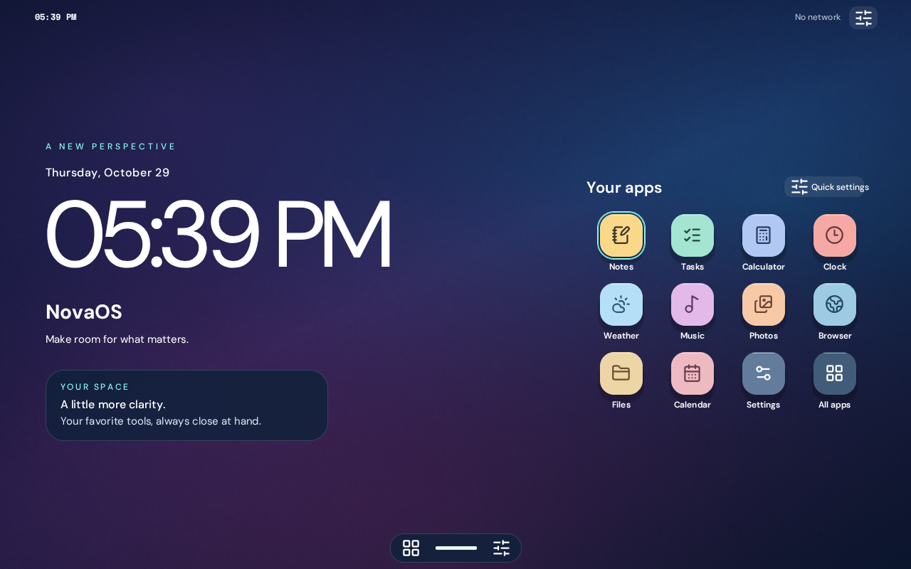

# NovaOS

NovaOS is a minimal Debian-based appliance OS that boots straight into the **NovaOS shell**. It follows the
same model as ChromeOS, webOS and KaiOS: a fullscreen web UI on top of Linux. There is no login prompt, no
desktop environment and no console text. You get the home screen with its clock, apps, glass dock and quick
settings, and every toggle controls the real device.



```
firmware → GRUB → Plymouth splash → systemd → sway (kiosk) → Chromium --app → NovaOS shell ⇄ novad (127.0.0.1)
```

- **The UI is the original design.** It is the single-file `ui.html`, kept pixel-faithful (the visual tests
  compare it against the original), made fully offline, and wired to a small local daemon called `novad`.
- **Real apps.** Notes, Tasks and Files are saved on a `NOVA-DATA` disk (Files are real files in
  `~/Documents`). The Browser app opens real websites in a separate, sandboxed Chromium window. Wi-Fi,
  Bluetooth, volume, brightness, time zone, battery and the power menu all control or reflect the hardware.
- **Reproducible.** Every build input is pinned. One command builds the ISO in a container, and one boots it
  in QEMU.

> **Status (honest):** all code is written and most of it is tested. The ISO itself has **not** yet been built
> or booted where this was developed, because that sandbox had no Debian mirror and no KVM. CI is set up to
> build and boot it on GitHub (`.github/workflows/ci.yml`). See [What has been verified](#what-has-been-verified).

**New here? → [INSTALL.md](INSTALL.md)** explains in a few steps how to download, try and install NovaOS.

---

## Quick start

You need Docker (or Podman), about 20 GB of free disk space and, to run it, QEMU.

```bash
git clone https://github.com/cmpe514/NovaOS && cd NovaOS
```
```bash
make doctor
```
```bash
make iso
```
```bash
make run
```

- **`make doctor`** checks everything and prints the exact command to fix anything missing.
- **`make iso`** builds `out/novaos-0.1.0-amd64.iso`. The first build takes 15–40 minutes.
- **`make run`** boots it in a QEMU window with sound, networking and a persistent data disk. Use
  `make run-uefi` for UEFI.

On first boot, open **Settings → Storage → Set up storage…**, pick the empty 8 GB disk and type its name to
confirm. From then on your notes, tasks, files, settings, Wi-Fi networks and time zone survive reboots.

| Command | What it does |
|---|---|
| `make doctor` | Check prerequisites, print fix commands |
| `make ui` / `make daemon` | Build the offline UI / the `novad` binary |
| `make iso` | Build the hybrid ISO (`ARCH=arm64`, `DEBUG=1` available) |
| `make run` / `make run-uefi` | Boot the ISO in QEMU (BIOS / UEFI) |
| `make smoke` | Headless boot test: BIOS + UEFI, screenshot check, persistence across a clean reboot |
| `make usb DEV=/dev/sdX` | Write the ISO to a USB stick (Linux) |
| `make test` | Go unit tests and the Playwright suites |
| `make dev` | Run the shell and `novad` on your desktop (fake device) for UI work |
| `make zip` | Package the sources as `out/novaos-src.zip` |

Building on macOS, on Windows/WSL2 or in a Debian VM is covered in [docs/BUILDING.md](docs/BUILDING.md).

## Running it in a virtual machine

### QEMU

`make run` picks the right accelerator: KVM on Linux, HVF on macOS, WHPX on Windows. The equivalent command,
so you can adapt it, is:

```bash
qemu-img create -f qcow2 out/data-amd64.qcow2 8G
```
```bash
qemu-system-x86_64 -machine q35 -accel kvm -cpu host -smp 2 -m 3072 \
  -drive file=out/novaos-0.1.0-amd64.iso,media=cdrom,readonly=on,if=none,id=cd \
  -device virtio-scsi-pci -device scsi-cd,drive=cd,bootindex=0 \
  -drive file=out/data-amd64.qcow2,if=virtio,format=qcow2 \
  -device virtio-vga -display default \
  -audiodev pa,id=snd -device intel-hda -device hda-duplex,audiodev=snd \
  -nic user,model=virtio-net-pci -device qemu-xhci -device usb-tablet -device usb-kbd
```

- **macOS:** replace `-accel kvm -cpu host` with `-accel hvf -cpu host` (Intel Macs), and `-audiodev pa` with
  `-audiodev coreaudio`. On **Apple Silicon**, an amd64 guest cannot be accelerated: build `ARCH=arm64` and
  run `make run-uefi ARCH=arm64`. The arm64 image is configured but not yet tested.
- **Windows:** use `-accel whpx` (enable *Windows Hypervisor Platform* in Windows Features) and
  `-audiodev dsound`.
- **UEFI:** add
  `-drive if=pflash,format=raw,readonly=on,file=/usr/share/OVMF/OVMF_CODE_4M.fd -drive if=pflash,format=raw,file=out/uefi-vars.fd`
  (copy `OVMF_VARS_4M.fd` to `out/uefi-vars.fd` first).

The explicit `intel-hda` audio device is what makes the Music app audible. `usb-tablet` keeps the mouse
pointer exact.

### VirtualBox

1. Create a new VM with type **Linux**, version **Debian (64-bit)**, 3 GB RAM and 2 CPUs. Leave *Enable EFI*
   off for BIOS or on for UEFI.
2. Under **Display**, set the graphics controller to **VMSVGA** and leave 3D acceleration off. NovaOS
   switches to software rendering by itself.
3. Under **Storage**, attach the ISO to the optical drive and add a new 8 GB VDI hard disk for your data.
4. Under **Audio**, set the controller to **Intel HD Audio**.
5. Boot, then set up the data disk from Settings → Storage.

### VMware Workstation / Fusion

Create a "Linux, Debian 12/13 64-bit" VM, attach the ISO, add an 8 GB disk and use the default sound card
and USB 3 controller. Accelerate 3D graphics can stay on or off.

### UTM (macOS)

- **Apple Silicon:** choose *Virtualize → Linux* with the **arm64** ISO, or *Emulate → x86_64* with the
  amd64 ISO (slow).
- **Intel Macs:** choose *Virtualize → Linux* with the amd64 ISO.

Add an 8 GB drive. Under Display, *virtio-ramfb-gl* or *virtio-gpu* both work.

## Putting it on a USB stick

**Linux:**

```bash
make usb DEV=/dev/sdX
```

The script refuses mounted disks, internal (non-removable) disks and the disk you are running from, and
asks you to type the device path again. Add `PERSIST=1` to create a NOVA-DATA partition in the free space
of the same stick:

```bash
sudo PERSIST=1 tools/write-usb.sh /dev/sdX
```

**macOS / Windows:** use [balenaEtcher](https://etcher.balena.io), or [Rufus](https://rufus.ie) in *DD image
mode*.

Then boot the computer from the stick (usually F12, F11, Esc or Option at power-on).

## Using NovaOS

- **The shell** is the original UI. Everything works without a network connection.
- **Browser app:** websites open in a separate Chromium window with tabs. To get back home, use any of these:
  - press the **Super/Windows** key or the keyboard's **Home page** key
  - tap **⌂ Home** in the bar at the bottom of the browser
  - close the browser window (NovaOS returns home automatically)
- **Keyboard:**
  - **Esc** closes panels and the photo viewer.
  - **Home** (outside text fields) returns to the home screen.
  - The calculator accepts digits, `+ - * /`, Enter, Backspace and Delete.
- **Power:** Quick settings → **Power…** → *Shut down* or *Restart*. Data is saved as you go, and the data
  disk is unmounted cleanly.
- **Boot menu:** hold **Shift** (BIOS) or press **Esc** (UEFI) right after power-on to see:
  - **Safe mode:** software graphics only, for odd GPUs or VMs.
  - **Recovery:** a text menu to check and repair the data disk, back up your data to a USB drive, reset the
    shell settings, or show system information.

## Developing

```bash
make dev
```

`make dev` builds the UI and `novad`, starts `novad --dev` with a **fake device** (Wi-Fi networks, a
battery, a USB stick, a blank disk) and opens the shell in a Chromium app window. Data lives in `.dev-data/`.
`SYSTEM=linux make dev` reads your real machine instead; power actions and disk formatting stay simulated in
dev mode.

```bash
make test NATIVE=1
```

The test suites are:

| Suite | What it checks |
|---|---|
| `daemon/…/*_test.go` | Storage atomicity and validation; auth; every request guard (DNS rebinding, CORS, CSRF, Origin); the Linux backend against stub `nmcli`/`wpctl`/… tools (exact command lines, no password on argv, invalid input never reaches a command) |
| `tests/e2e/parity.spec.js` | Every item of the original feature checklist |
| `tests/e2e/offline.spec.js` | Zero requests to any host other than 127.0.0.1; no Canva leftovers; vendored files and licences present |
| `tests/e2e/visual.spec.js` | Screenshots at 1440×900, 820×1180 and 390×844 against a render of the original markup |
| `tests/e2e/device.spec.js` | The UI through `novad`: persistence, real files, status bar, radios, volume/backlight, power menu, Browser app, storage setup, and an attacker page in the same browser profile |
| `tests/session/shell-network-test.sh` | Net-log proof that the shell browser makes no connection beyond 127.0.0.1 (Chromium's own Google background requests are blocked) |
| `tests/session/session-test.sh` | The real sway session headless: shell fills the screen, `NOVAOS_READY`, browser on its own workspace with the Home bar, Super returns home, closing the browser returns home |
| `tools/smoke-qemu.sh` | Boots the ISO in QEMU (BIOS and UEFI), waits for `NOVAOS_READY`, checks the screenshot is not blank, and boots twice with one data disk |

### Renaming the project

Edit `nova.config.json`: name, tagline, version, accent palette, hostname, user name and port. Then rebuild.
Nothing else needs to change.

## What has been verified

**VERIFIED** means it was run during development and passed.

| Item | Status |
|---|---|
| Offline UI build, zero third-party requests, all 11 apps, the whole parity checklist | **VERIFIED** (Playwright, 33 tests) |
| UI identical to the original at 3 sizes (vendored fonts/Tailwind; `NOVA_REFERENCE_CDN=1` compares against the real CDNs) | **VERIFIED** |
| `novad`: storage, auth, request guards, system backend command lines, weather client | **VERIFIED** (Go tests incl. `-race`) |
| UI ⇄ `novad` integration incl. cross-origin attack tests | **VERIFIED** (Playwright device suite, 9 tests) |
| sway kiosk session: shell, Home bar, Super key, auto-return, `NOVAOS_READY` | **VERIFIED** headless (software rendering, Playwright's Chromium) |
| The shell browser opens no connection beyond 127.0.0.1 (net-log) | **VERIFIED** with Playwright's Chromium (Debian's build is assumed to behave the same or better) |
| QEMU smoke harness (BIOS + UEFI boot, serial marker, screenshot, blank check) | **VERIFIED** on a stand-in GRUB ISO |
| live-build tree renders with no unresolved placeholders; all shell scripts pass shellcheck | **VERIFIED** |
| `make iso` produces a bootable ISO (1,145 MiB) | **VERIFIED** in GitHub Actions (Debian live-build in the builder container) |
| The ISO boots to the NovaOS home screen (QEMU/KVM, direct kernel boot) in 23 s | **VERIFIED** in GitHub Actions (`NOVAOS_READY uptime=23.37s`) |
| BIOS + UEFI boot through GRUB, persistence across a clean reboot | being verified by CI's `iso` job (`make smoke`) |
| Builder container, `make doctor` on macOS/Windows | **UNVERIFIED** |
| Real NetworkManager, BlueZ, PipeWire, logind backlight, udisks2, polkit rules, Plymouth handover, squeekboard | **UNVERIFIED** (command lines unit-tested against stubs) |
| VirtualBox, VMware, UTM, real hardware, Secure Boot | **UNVERIFIED** |
| arm64 image | **UNVERIFIED** (configured, never built) |

The original `ui.html` in this repository is **truncated** at line 543. Its missing end (save, delete and
toggle handlers, and start-up) was rebuilt from the surviving code; see
[ui/original/README.md](ui/original/README.md).

## Troubleshooting

When something fails, run it again with `VERBOSE=1` and paste the last 40 lines of the output (or of
`out/build-*.log`).

| What you see | Meaning and fix |
|---|---|
| `make iso`: "docker is installed but not running" | Start Docker Desktop, or run `sudo systemctl start docker` |
| `make iso`: "privileged containers do not work" | Rootless Podman cannot do this; run `sudo make iso` |
| `lb build` fails while downloading | A mirror hiccup. Run `make iso` again (downloads are cached) or set a closer mirror: `NOVA_MIRROR=http://ftp.de.debian.org/debian/ make iso` |
| `lb build` fails about the bootloader / `grub-pc` | Your live-build cannot use GRUB for BIOS ISOs. Run `NOVA_BOOTLOADERS="syslinux grub-efi" make iso` |
| `make run` is extremely slow | No hardware acceleration. Run `make doctor` for the fix (KVM group, enable VT-x/AMD-V, or HVF/WHPX) |
| Black screen or a flashing cursor after the splash | The GPU path failed. Reboot and choose **Safe mode** (hold Shift / press Esc at power-on) |
| Settings says "Changes won't be saved" | There is no NOVA-DATA disk. Use Settings → Storage → Set up storage…, or create one on another Linux machine: `sudo mkfs.ext4 -L NOVA-DATA /dev/sdX1` |
| The data disk is not mounted after a crash | `e2fsck` found errors it would not fix automatically. Boot **Recovery** → *Check and repair the data disk* |
| No sound in QEMU | Keep `-device intel-hda -device hda-duplex`, and check the host audio backend (`-audiodev pa` / `alsa` / `coreaudio`) |
| The PC refuses to boot the stick (Secure Boot) | Disable Secure Boot in the firmware settings (UEFI menu → Security / Boot). The image does not use Debian's signed shim yet |
| Wi-Fi not listed | The adapter may need firmware that is not in Debian's non-free-firmware section; check `lspci -k` in a `DEBUG=1` build |

## Documentation

- [docs/ARCHITECTURE.md](docs/ARCHITECTURE.md): the decision record, boot flow, repository layout, and risks
  and unknowns.
- [docs/SECURITY.md](docs/SECURITY.md): privileges, the `novad` auth model, network traffic, release vs.
  debug images.
- [docs/BUILDING.md](docs/BUILDING.md): container, native and VM builds, build options, arm64, renaming.
- [THIRD_PARTY_LICENSES](THIRD_PARTY_LICENSES) and [CREDITS](CREDITS).

## Not done yet (stretch goals)

These are not implemented:

- lock-screen PIN
- notifications
- translations and RTL layout
- install-to-disk
- A/B updates
- Secure Boot (shim)
- disk encryption
- running the web browser as a separate user
- a measured boot under 15 s

The arm64 image is configured but untested.
